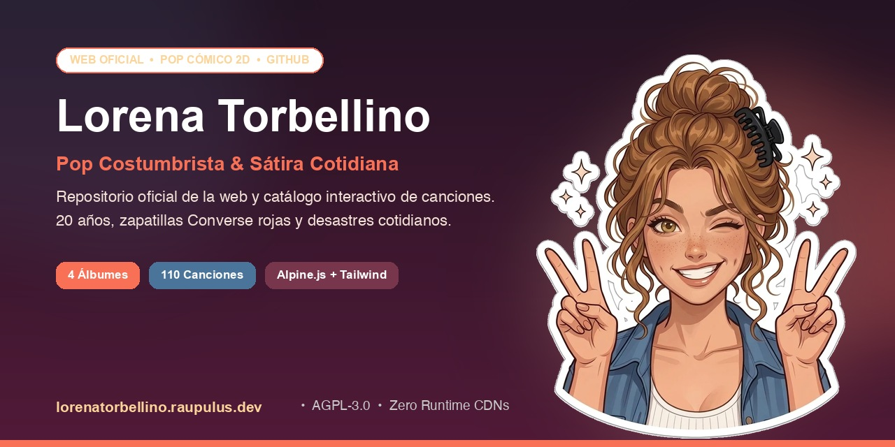

# 🌪️ Lorena Torbellino — Web Oficial

 

  

### 💖 Pop costumbrista, sátira cómica cotidiana y desastres a los 20 años

> **«20 años, voz dulce, zapatillas Converse rojas y un talento casi sobrenatural para que todo en la vida salga al revés.»**

 

---

## ✨ ¿Quién es Lorena Torbellino?

**Lorena Torbellino** es un proyecto musical de comedia absurda, pop costumbrista y sátira de la vida cotidiana protagonizado por una joven española de 20 años, risueña, carismática y descarada.

Entre sus señas de identidad destacan sus inseparables **zapatillas retro rojas tipo Converse**, su característico **moño alto despeinado (*messy bun*) con pinza negra de garra**, aros plateados, pecas risueñas y una afición desmedida por meterse en líos cotidianos de los que siempre sale con una sonrisa y una canción pegadiza.

---

## 🎧 Discografía Oficial (4 Álbumes · 110 Canciones)

En la web oficial puedes descubrir, filtrar y explorar el catálogo íntegro de Lorena clasificado por disco y relatos temáticos:

| Álbum | Temática y Canciones Destacadas | Pistas |
| :--- | :--- | :---: |
| **CD 1: Cosas de la vida real** | Caos doméstico, atascos con estropajos, el misterio del calamar en el fregadero, perder el coche en el parking del Carrefour y pereza legendaria. | **21 temas** |
| **CD 2: Me pasa de todo** | La Ley de Murphy elevada a himno pop, gazpachos explosivos, babuchas con pompón, gafas extraviadas y citas desastrosas. | **33 temas** |
| **CD 3: Que locura** | Fantasías surrealistas, enredos cómicos a toda velocidad, aventuras delirantes y el día a día llevado al límite del absurdo. | **32 temas** |
| **CD 4: Problemas de viejoven** | Dolores de espalda prematuros a los 20 años, crujidos de rodilla al levantarse del sofá, lumbagos inoportunos y la odisea de madrugar. | **24 temas** |

---

## 🌐 ¿Qué encontrarás en la Web Oficial?

Visita [**lorenatorbellino.raupulus.dev**](https://www.lorenatorbellino.raupulus.dev) para disfrutar de la experiencia completa:

- 🔍 **Buscador y Filtros Interactivos:** Encuentra canciones al instante filtrando por álbum o por tipo de relato (*Crisis de Viejoven*, *Desastres Cotidianos*, *Citas & Vida Social*, *Vida Real & Rutina*, *Animales & Campo*).
- 🎬 **Videoclips en Alta Definición:** Enlaces directos a cada videoclip oficial estrenado en el canal de YouTube.
- 📜 **Letras Oficiales sin Spoilers:** Lee las letras completas de los temas estrenados y consulta la ficha técnica de cada pista.
- 🎀 **Quién es Lorena:** Conoce su biografía cómica ilustrada, sus hábitos extravagantes y una galería de gags y poses visuales.
- ⚡ **Experiencia Instantánea:** Interfaz 100% autónoma y estática, ultraligera, optimizada para móviles y sin rastreadores invasivos de privacidad.

---

## 📺 Canal Oficial de YouTube

Todos los videoclips animados, estrenos y canciones se publican en el canal oficial:

▶️ **Canal:** [YouTube @LorenaTorbellino](https://www.youtube.com/@LorenaTorbellino)  
🔔 **Suscripción directa:** [Suscribirme a Lorena Torbellino](https://www.youtube.com/@LorenaTorbellino?sub_confirmation=1)

---

## 📄 Licencia y Derechos de Autor

Este proyecto cuenta con un modelo de licencia dual:

1. **Código y Diseño del Sitio Web:**  
   Publicado bajo licencia abierta **[GNU Affero General Public License v3.0 (AGPL-3.0)](LICENSE)**.
2. **Contenido Musical, Personaje y Letras:**  
   La música, interpretaciones sonoras, composiciones, letras, universo narrativo y el personaje de **Lorena Torbellino** son propiedad intelectual privada.  
   ℗ & © 2026 Lorena Torbellino. Todos los derechos reservados.

---

## 📬 Contacto y Autoría

- **Desarrollo y autoría web:** [raupulus.dev](https://raupulus.dev)
- **Correo de contacto público:** [`public@raupulus.dev`](mailto:public@raupulus.dev)
